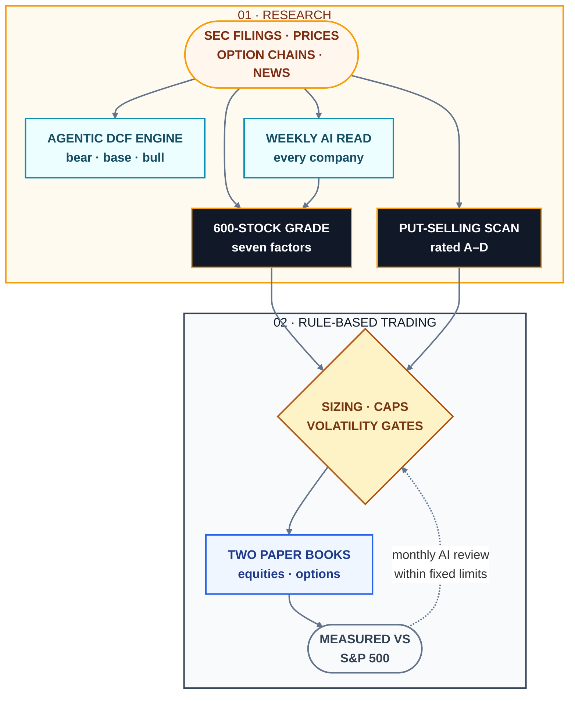

# Agentic Research & Trading Platform

AI agents and rule-based code research about 600 US stocks every weekday,
build full valuation models from SEC filings, and run two paper trading
strategies on what they find — each measured against the S&P 500.

**Live read-only demo: [agentic-research-trading.vercel.app/demo](https://agentic-research-trading.vercel.app/demo)** — production data, no sign-in, and no way to place an order.

This repository is the public technical overview of the platform. The full
source is private because it runs continuously against connected brokerage
accounts; the documents here explain what it does, how it is built, where AI
is used and where rules decide, and what has been measured — including the
results that were not flattering.

## System at a glance

AI does the reading, the valuation modeling, and the judgment calls on trades
that have gone wrong. Rules decide every new position. No model output can
place an order on its own, and the public demo has no path back into trading
controls.

## Where AI is used and where rules decide

| Part | AI's role | What stays rule-based |
|---|---|---|
| **Equity research** | Claude reads every company each week and scores the business; Claude creates full bear/base/bull DCF models for eligible companies. | The 0–100 grade, its factor weights, and the screen's own DCF. |
| **Options research** | An AI analyst researches the 20 best put-selling candidates on the web, writes up the risks, and scores 1–10 how willing it would be to own the shares. | Each contract's score and A–D rating. |
| **Equity trading** | Once a month an AI reviews results against the S&P 500 and adjusts settings, only within fixed limits. | Every buy and sell. The AI never picks stocks. |
| **Options trading** | When an open trade moves against the book, an agent researches the company and decides whether to hold, close early, or roll. | Which puts to sell, the cash reserve, and hard stops the agent cannot override. |

Models in use: Claude Opus 5.5 and Sonnet 5.5 for valuation models, Claude
Haiku 5.5 for the weekly reads, Gemini 2.5 Flash with Google Search grounding
for options research and trade management (falling back to Claude, then to
rules), and local models served through Ollama for the monthly review and
hourly news research.

## Equity research

Every weekday each company in a ~600-stock US universe gets a grade from 0 to
100. The grade blends seven weighted measures: value against its industry
(25), quality (20), growth (20), price momentum (20), analyst expectations
(10), news tone (5), and the weekly AI read (5). Thin data lowers a grade
rather than being guessed.

**Screen DCF.** A 10-year cash-flow valuation, with growth fading to a
long-run rate and a Gordon terminal value, runs beside the grade as a second
check on price. A result is trusted only if it clears thirteen gates. One
gate now values multi-class companies on every share class: before the fix,
fair value was overstated by up to 5× on 51 of 625 names. Only a DCF that
clears its gates may drive a holdings action. In the browser, a live
spreadsheet with editable assumptions reproduces each published value to the
cent.

**Agentic DCF engine.** For eligible companies, Claude builds a full
banking-style model:

- bear, base, and bull cases over a 10-year projection, with three 5×5
  sensitivity grids where every cell is a live formula;
- inputs from SEC XBRL filings (five fiscal years plus the trailing twelve
  months) and the FRED 10-year yield. The model is deliberately not shown the
  screen's fair value or the analyst target, so its view is independent;
- the default engine sends one Message Batches API request per company and
  asks the model only for its assumptions, as JSON in a fixed schema. Python
  then writes the workbook and computes every case, matching the original
  headless agent's base value to within 1%;
- before a model is published, LibreOffice recalculates the workbook under
  each case. The model is rejected if any formula errors, if the summary
  disagrees with the recalculated cells, if price ≠ (EV − net debt) / shares,
  if bear ≤ base ≤ bull fails, or if WACC, terminal growth, terminal-value
  share or fair value fall outside sane bounds;
- scheduled batches stop if fewer than half of a batch pass;
- new 10-K and 10-Q filings trigger refreshes. Financials, REITs,
  pre-profit companies and non-SEC filers are never modelled. Nearly 170
  models are published on the demo.

The deep models are advisory. They feed neither the grade nor either trading
book.

**Weekly AI read.** Once a week Claude reads every research and held company
and returns five 0–10 scores (business quality, growth durability, financial
resilience, risk outlook, valuation against quality), a conviction, a
one-line thesis and a one-line risk. The prompt withholds the screen's score,
tier, DCF and analyst target. Scores enter the grade as weekly percentiles,
and only once 90% of the universe has a fresh read. The read replaced a
local-model verdict that covered 35 of 598 names and said SELL on 77% of
them. The first full run covered 608 names with zero errors.

## Options research

Each morning the scanner looks for the best stocks to sell cash-secured puts
on. Every contract is scored out of 100 and rated A to D. The weights come
from replaying 2,150 past picks to expiry. The heaviest are the chance the
option expires worthless and how far the stock can fall before the trade
loses money. Business quality, option liquidity and distance from earnings
count too, and premium size counts least.

## Trading books

| Book | Account | Mandate |
|---|---|---|
| **Equity trader** | Alpaca, $1M paper | Long-only. Holds the 15–22 best-graded stocks beside a broad index fund, with more weight on stronger conviction and deeper discounts to estimated value. Caps: 8% per stock, 30% per sector. Holds more Treasury bills when few stocks look compelling. Sells half after a 30% gain, exits after a 15% loss, and exits when the grade falls below 45. |
| **Options trader** | Alpaca, $100K paper | Cash-secured-put wheel, run three times each trading day. Takes profit at 80% of premium. Sells covered calls on assigned shares. A volatility gate halves new size above VIX 25 and stops new opens above 35. |

Both books trade paper capital at live prices. The point is to test the
machinery under real conditions, not to curate good returns, so the demo
reports every result against the S&P 500, including the unflattering ones.

## Recent engineering work

- **Stopped same-day churn in the equity book.** Of 321 closed positions, 57%
  had closed within three days. Three rules fixed it: a held name keeps its
  slot while it ranks inside the top 1.5× of slots, a five-day minimum hold
  applies (stop-losses still fire), and the book never buys a name its sell
  rules would reject. A test checks the buy and sell rules agree across 1,344
  combinations. Modeled turnover fell from 75× to 38× and friction from 3.0%
  to 1.5%.
- **Replayed the put-selling rules on real option prices.** The replay used
  Alpaca daily option bars, expired contracts included, from Jan 2024 to
  Nov 2026: 11,087 stock-month chains and 374,638 candidate puts. A $100K
  account ran through the live sizing, cash floor, volatility gate, sector cap
  and exits, paying 4% of the option price per side plus fees. The live setup
  returned +5.2% a year (max drawdown −12.7%, 81% win rate over 1,253 trades)
  against the S&P 500's +14.7%. Widening to the 300 most-traded stocks did
  worse in every one of 200 robustness trials. The universe and price cap
  stayed. The strategy trails the index, and the replay is reported as a
  decision tool, not a performance claim.
- **Fixed a silent volatility-gate failure.** The fallback volatility measure
  read about 0.55× the real VIX, so the risk gates had not been firing. The
  gate now tries the official VIX close from several sources first.
- **Measured the options cash reserve against free cash.** The paper wheel
  had held $68,850 of short-put collateral against $50,702 of cash while
  reporting $36,000 deployable. Collateral is now netted out, and unreadable
  collateral counts as fully committed.
- **Hardened the public gateway.** Account namespaces are closed by default,
  only nine research routes are open, and ownership and P&L fields are
  stripped. Tests require the public answer to be identical whichever account
  sits behind it.

## The demo

The [demo](https://agentic-research-trading.vercel.app/demo) is a guided,
read-only walk through the platform built from the same components and live
API as the private dashboard:

- [Overview](https://agentic-research-trading.vercel.app/demo): one section per part, with its headline finding.
- [Equity research](https://agentic-research-trading.vercel.app/demo/research): the ranked universe, valuations, full DCF models and the editable spreadsheet.
- [Options research](https://agentic-research-trading.vercel.app/demo/options-research): the morning scan, the rating weights, the AI analyst's write-ups.
- [Equity trading](https://agentic-research-trading.vercel.app/demo/equities): the book against the S&P 500, holdings, sectors and rules.
- [Options trading](https://agentic-research-trading.vercel.app/demo/options): open positions, collateral against cash, closed trades and the replay.

Every number comes from the public API. A missing figure removes its tile
rather than breaking the page.

## Public/private boundary

The demo is the production front end compiled with a view-only flag and
served from Vercel. Its API calls are rewritten to a read-only gateway on the
server.

- **Personal brokerage data** — holdings, cost-basis P&L, orders and
  watchlists — is not served at all. Selecting a symbol shows research, never
  a position.
- **Interactive AI workflows** need write requests, so the gateway rejects
  them and serves labelled cached analysis instead.
- **Operational controls** are removed from the public bundle at compile time
  and independently rejected by the gateway with HTTP 403.
- **Spend and model routing** for the valuation engine stay private.

## Technical documentation

The documents below were written while the platform's main research program
was a BTC 15-minute prediction lab on Kalshi. That lab is no longer part of
the public demo, but its methodology, safety and infrastructure lessons carry
over to everything above.

- **[Engineering case study](docs/ENGINEERING.md)** — scope, the hardest engineering problems, and the evidence available for review.
- **[Methodology](docs/METHODOLOGY.md)** — measured transaction costs (which repriced the leading strategy from +$67.53 to −$26.50), multiple-testing correction across 33,000 trials, and three studies whose conclusion was not to proceed.
- **[Safety](docs/SAFETY.md)** — sandboxing LLM-generated strategy code, and the independent controls that keep live execution under explicit human authorization.
- **[Architecture](docs/ARCHITECTURE.md)** — the full runtime on a four-core, 8 GB server, priority-aware scheduling, and deployment incidents.
- **[Design](docs/DESIGN.md)** — the dashboard's data-integrity rules: every metric carries its measurement window, calibrated values keep their precision, and color signals risk.

## Technology

Python 3.12 (NumPy, pandas, openpyxl); FastAPI; Next.js 14, React and
Tailwind; systemd services and timers on a single Linux VPS; the Anthropic API
including Message Batches; Gemini; local inference through Ollama;
LibreOffice for model recalculation; Alpaca; SEC EDGAR XBRL, FRED and Finnhub
data; GitHub Actions deployment; and Vercel for the public front.

## Related project

[Concordia](https://github.com/rohanjoglekar/voteconcordia) is a real-money,
vote-governed investment club that executes one shared portfolio inside each
member's own brokerage account. It shares this project's operating principle:
keep running where that protects people, and fail closed wherever uncertainty
could touch capital.

## Operating status

Research runs every weekday and both books trade paper accounts at live
prices. Switching to live trading is a manual, human-authorized step by
design.

Contact: rohannj29@gmail.com
