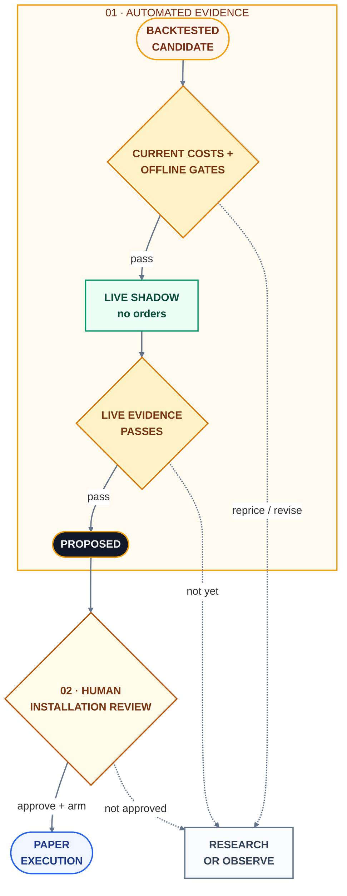

# Engineering case study — Agentic Research & Trading Platform

This engineering case study explains what the platform demonstrates as a production
software project, which technical problems required the most judgment, and
what evidence an employer can evaluate in this public repository. The source
for the equity research, options research and both paper books is published
here. This document is the system-level account, and it also covers the parts
that stay private: the API server, the BTC research lab and everything that
reads a brokerage account.

## Project scope

The platform combines quantitative research automation, market-data processing,
statistical validation, model-assisted strategy generation, paper execution,
operational monitoring, and a full-stack dashboard on one continuously running
Linux server. The private monorepo spans Python research and trading services,
typed web applications, broker and venue adapters, local-model workloads,
service definitions, deployment automation, and more than 1,200 Python test
functions distributed across the platform's research, execution, adapter, and product
services.

The engineering objective is not simply to discover a profitable backtest. It
is to build a controlled path from hypothesis generation to production
observation while preserving the economics, evidence, and operational state
required to decide whether a result should be trusted.

## Two-stage promotion path

The automated pipeline can advance a candidate only as far as **proposed**.
The final transition into an executing paper book remains an explicit human
decision, preserving a clear boundary between statistical eligibility and
operational authority.

## Hard problems and decisions

| Problem | Engineering decision | Public evidence |
|---|---|---|
| Backtests can manufacture performance through optimistic friction. | Price every result with venue-specific fees and observed order-book spread, then version those economics independently from engine releases. | The binary shadow book was repriced from +$67.53 to −$26.50 after measured spread replaced a theoretical estimate. |
| Searching thousands of candidates makes chance winners inevitable. | Raise the promotion threshold with concurrent candidate count and reserve chronological holdout data for final evaluation. | Promotion is held to a Bonferroni floor that rises with the number of concurrent shadow tests, on a chronological train/validation/holdout split. |
| Generated Python is useful for research but unsafe to trust. | Combine static syntax screening, process resource limits, non-executable result transport, and network-isolated OS sandboxing. | The safety document describes the independent containment layers and their threat assumptions. |
| Offline and live behavior can silently diverge. | Reuse decision and exit logic across backtesting and shadow evaluation, then reconcile live signal frequency against historical expectations. | The stop-loss ordering incident shows why shared code paths and parity tests are safety properties. |
| Research can starve latency-sensitive services on a small server. | Run research at low priority and throttle only against normal-priority CPU consumption rather than priority-blind load average. | The original governor yielded 307 times in 5¼ hours and left the lab idle 73% of that time; the revised one does not count its own low-priority work. |
| A public portfolio piece must be credible without exposing production control. | Compile the public app in view-only mode, enforce GET-only access at the gateway, and refuse every account route there so the public answer does not depend on the account. | The live demonstration reads the production API through that gateway. The policy and its tests are in this repository. |

## Verification strategy

The platform uses verification appropriate to each boundary rather than treating one
test suite as sufficient:

- Pure research and accounting logic is exercised through unit and regression
  tests, including parity checks between offline and online decision paths.
- Strategy promotion uses chronological data separation, risk-adjusted
  statistics, economics-version compatibility, and minimum evidence floors.
- Shadow testing runs live predictions without orders and compares production
  behavior with backtest expectations.
- Paper books exercise venue connectivity, scheduling, state persistence,
  reconciliation, and reporting without authorizing real capital.
- Operational controls monitor service freshness, serialize deployments, and
  preserve safe fallback behavior when telemetry or data is unavailable.

## Selected engineering outcomes

- Recalibrated transaction costs even when the correction eliminated apparent
  profitability, preserving the integrity of downstream promotion decisions.
- Converted a priority-blind compute throttle into a workload-aware governor
  suitable for mixed research and trading services on constrained hardware.
- Traced a ten-day deployment failure to Git object semantics rather than the
  package manager, and changed the ignore rule so a symlink can no longer be
  tracked in that path.
- Preserved negative research programs as first-class results, preventing
  unsupported maker, timeframe, and pair-trading work from advancing.
- Built a public surface beside the private one, with capability removed at
  the build, gateway, and data layers.

## What an employer can evaluate

The repository supports a review at three levels. The live demonstration is
behavioral evidence. The source for the four parts can be read and its tests
run without keys. The linked documents give the reasoning, the incidents and
the measured outcomes, including for the parts whose source stays private.

## Intentional omissions

Not included: the API server, anything that reads a brokerage account,
credentials, account identifiers, holdings, raw operational logs, internal
network details, deployment and recovery commands, and the BTC research lab's
source. These omissions protect the production environment and the account
while leaving the architecture, failure modes, controls, and engineering
results open to review.
